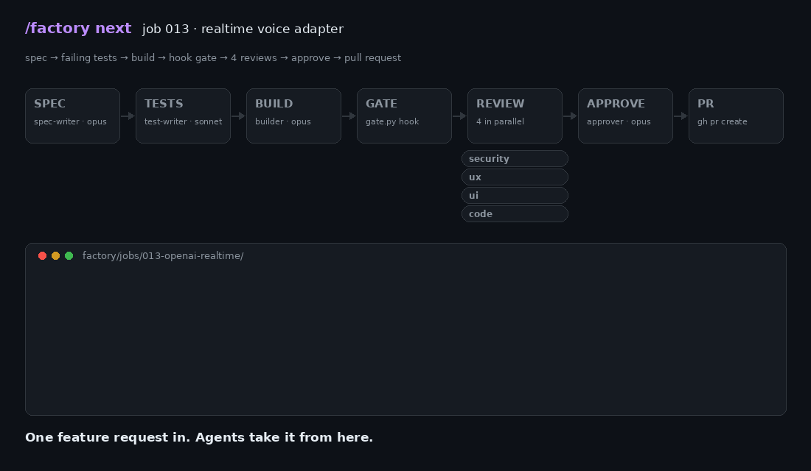
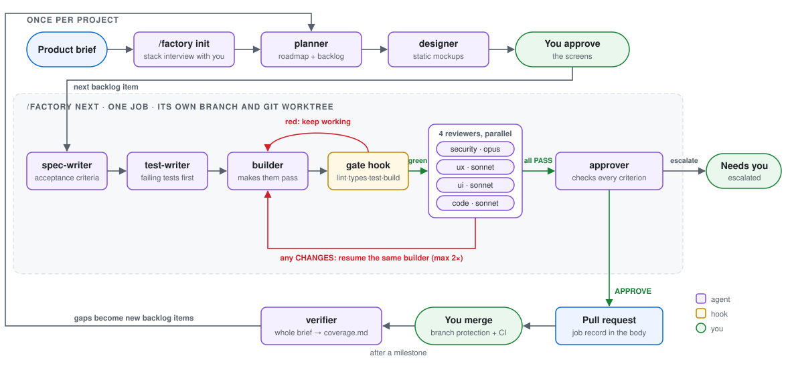

# Software Factory for Claude Code

**A product brief goes in. Reviewed, tested pull requests come out.**

Eleven Claude Code subagents, one orchestrating skill and three Python hooks
turn a written brief into a roadmap, then build it one feature at a time:
spec → failing tests → code → four parallel reviews → approval → pull request.
The rules that matter (tests must be green, protected files stay untouched,
nothing reaches `main` without a human) are enforced by hooks, not by
asking the model nicely.



*A real job from the project this factory built, replayed. The security
reviewer found that an API key could leak through an error message, sent the
build back, then caught that the first fix was incomplete.*

---

## What it did on a real project

I used the factory to build the foundations of a multi-tenant SaaS backend
(TypeScript, Fastify, Next.js, PostgreSQL with row-level security). The repo
is private, but here is what the job records show:

| | |
| --- | --- |
| Features shipped | **19**, each as its own pull request |
| Commits on `main` | **101**, most naming the requirement they cover (`FR-AUTH-01`) |
| Sent back by the security reviewer | **4 jobs** (one of them twice) |
| Escalated to me, first 11 jobs | **5** |
| Escalated to me, next 8 jobs | **0**, after I turned those answers into `docs/policies.md` |
| Typical job, request → open PR | **20–60 minutes**, unattended |

The security reviewer earned its place. Four things it caught before a human
ever saw the code:

- **A ReDoS in the log redactor.** The email-scrubbing regex took over 8
  seconds on an 80 KB string, on a path that runs on every log call. It
  proposed bounded quantifiers and a timing test.
- **Cross-tenant data capture.** A nested ORM write could re-parent another
  tenant's API key into the caller's tenant, even though every query was
  "scoped".
- **A rate limit you could bypass in parallel.** The failed-login counter was
  checked before an `await` and incremented after it, so concurrent requests
  got far more guesses than the limit allowed.
- **An API key leaking through an exception**, and then, in round two, the
  edge case (a key ending in a newline) that the first fix missed.

## How it works



**Agents talk through files, not chat.** Each agent reads its inputs from the
job folder and writes exactly one file whose first line is machine-checkable:
`STATUS: READY`, `VERDICT: CHANGES`, `GATE: PASS`, `APPROVE`. The
orchestrator only moves the job along and keeps `job.json` current. Every job
leaves a full paper trail in `factory/jobs/<id>/`.

| Agent | Model | Job |
| --- | --- | --- |
| planner | opus | Brief → milestones, jobs, requirement IDs, dependencies, owned paths |
| designer | opus | Static HTML/CSS mockups per screen, iterated until you approve |
| spec-writer | opus | Acceptance criteria, plus a header saying what it covers and touches |
| test-writer | sonnet | Failing tests from the spec, before the builder sees it |
| builder | opus | Makes the tests pass on `factory/<job-id>`, commits, writes an ADR |
| reviewer-security | opus | Threat-focused review of the diff |
| reviewer-ux / ui | sonnet | Runs the app in a browser and compares it with the approved mockup |
| reviewer-code | sonnet | Correctness, and that the builder didn't weaken the tests |
| approver | opus | Checks every criterion, applies `docs/policies.md`, approves or escalates |
| verifier | opus | After a milestone: fresh checkout, every scenario in the brief, coverage report |

### Guardrails that a prompt can't talk its way around

Claude Code hooks run outside the model, so they hold in every permission
mode, including `--dangerously-skip-permissions`.

- **`guard.py`** (`PreToolUse`) blocks edits to secrets, lockfiles, CI,
  deploy config and migrations, and blocks force-push, pushing to `main`,
  local merges and deploy commands. A human unlocks one path for one job with
  `/factory allow`.
- **`gate.py`** (`SubagentStop`) won't let the builder or test-writer finish
  until the branch is clean, no protected path changed, the test-writer only
  touched test files, and every validation command passes. On failure the
  agent gets the output back and keeps working.
- **`session-start.py`** tags each session so several jobs can run in
  parallel, each in its own worktree, without stepping on each other.

## What I changed from the original

This started as a fork of
[zazencodes' software factory](https://github.com/zazencodes/zazencodes-season-3/tree/main/src/software-factory-claude-code)
(v1: seven agents and a skill, merging to `main` locally). I kept its core
idea, agents passing markdown files through a review loop, and rebuilt most
of the rest for production use:

| Original | This version | Why |
| --- | --- | --- |
| Rules live in the prompts | **Hooks enforce them** | An agent under pressure will find a reason to skip a rule. It can't skip a hook. |
| Builder writes its own tests | **Independent test-writer** goes first | A builder that writes its own tests grades its own homework. |
| Auto-merge to `main` | **Opens a PR** with the job record | Branch protection, CI and a human stay the last gate. |
| Starts at a feature | **`/factory init` interview + planner** | Stack, database, auth and hosting are decided once, with reasons, before any code. |
| — | **Design-first** | UI jobs wait until you approve static mockups. The builder re-implements them in the real stack instead of copying the HTML. |
| — | **Verifier + `coverage.md`** | Merged PRs don't prove the product works. The verifier checks the whole brief and turns gaps into new jobs. |
| — | **`docs/policies.md`** | Questions you've answered once become standing rules the approver cites. |
| One job at a time | **Parallel jobs** via git worktrees | Run `/factory next` in several sessions. |

Since then, zazencodes has published a
[v2](https://github.com/zazencodes/zazencodes-season-3/tree/main/src/software-factory-claude-code-v2)
that works from GitHub issues. Worth a look too.

## What I learned

- **Enforcement beats instruction.** A prompt saying "never edit the
  lockfile" or "don't finish on red tests" is a suggestion the model weighs
  against getting the job done. A hook that denies the edit or refuses to let
  the agent stop is not. Every rule I actually cared about ended up as a hook.
- **Escalations are a to-do list for your policies.** Five of the first eleven
  jobs stopped for a human decision, mostly the same questions (may I add this
  dependency, what are the rate limits). Writing the answers down once took the
  next eight jobs to zero escalations.
- **The expensive reviewer is the one worth paying for.** Security runs on the
  larger model, and it was the only reviewer that blocked jobs, with findings
  backed by measurements and reproductions rather than opinions.
- **Requirement IDs make the output auditable.** Because every spec, test
  block and most commits name the requirement they cover (`FR-AUTH-01`), the
  verifier can produce a coverage table instead of a vibe.
- **Design approval has to come first.** Reviewing UI after it's built in a
  real framework is slow and expensive to change; a static mockup takes a
  minute to revise.

## Quick start

You need [Claude Code](https://docs.claude.com/en/docs/claude-code/overview),
`python3`, git and an authenticated [`gh`](https://cli.github.com/) CLI. For
projects with a UI, install
[`agent-browser`](https://github.com/vercel-labs/agent-browser) so the
reviewers can look at the running app.

```bash
# in your project root
git clone https://github.com/Anishyou/claude-software-factory /tmp/sf
cp -r /tmp/sf/.claude /tmp/sf/factory .
mkdir -p docs && cp /tmp/sf/docs/policies.md docs/   # standing decisions
cat /tmp/sf/CLAUDE.factory-template.md >> CLAUDE.md
echo "factory/jobs/" >> .gitignore
```

Turn on branch protection for `main`, put your brief in `docs/build-brief.md`
(there's a small example in [`examples/`](examples/build-brief.example.md)),
open Claude Code and run:

```
/factory init      interview: stack, database, auth, hosting, tests
/factory plan      brief → roadmap + backlog
/factory next      build the next backlog item into a pull request
/factory status    where every job stands
```

Watch progress on the dashboard:

```bash
cd factory && python3 -m http.server   # open http://localhost:8000/dashboard.html
```

Every command, the hook details and configuration are in
[`docs/FACTORY.md`](docs/FACTORY.md).

## Costs and caveats

- A job costs roughly one opus spec, one sonnet test pass, one to three opus
  builds, four reviews per round and one opus approval. It's not cheap; it's
  cheaper than the bug the security reviewer catches.
- The factory gets you to "reviewed and tested", not "done". You still read
  the PRs, especially anything under `.claude/` or `factory/`.
- Tested on Windows (Git Bash) and Linux. The hooks only need Python 3.

## License

GPL-3.0, the license zazencodes publishes the factory under (v2). See [LICENSE](LICENSE).
