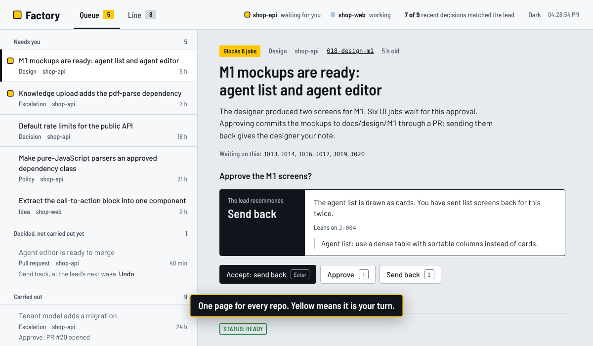
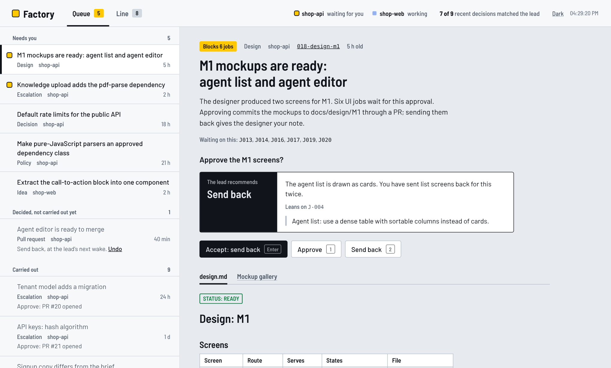
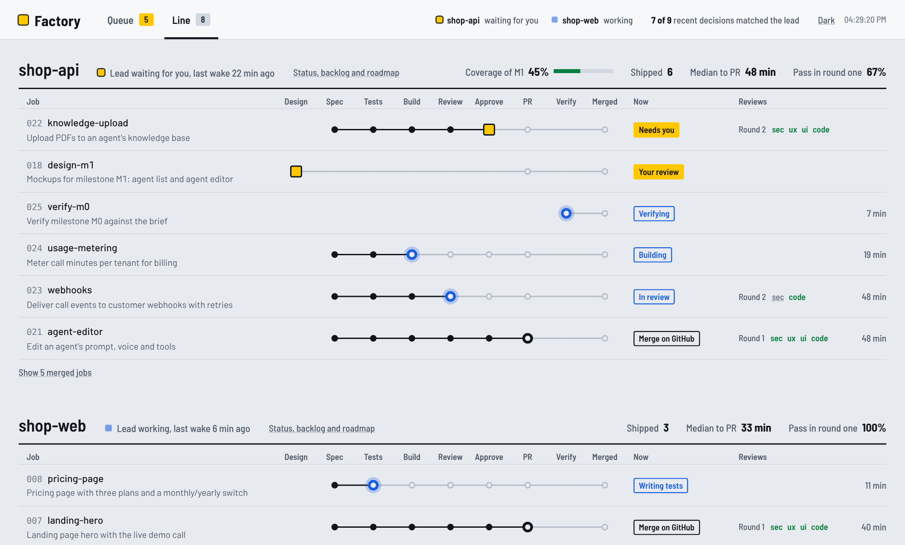

# Lead

**Runs the [Software Factory](../README.md#software-factory-for-claude-code) between your visits and puts everything it needs from you on one dashboard.**

The factory builds a job when you tell it to, and tells you in the terminal
when it needs you. With several jobs and several repos that means a dozen
chats to keep an eye on. The lead is a second skill that keeps each repo
moving on a schedule and reports to one local page, so you work from the
page and not from the chats.



*Recorded from the real dashboard on demo data. Yellow always means it is
your turn.*

It adds to the factory and changes nothing in it: every file of the lead is
in this folder, and the factory's skill, agents, hooks, config and board stay
exactly as they are.

Status: new. The dashboard and its server are tested. The `/lead` skill has
not yet been run through a full project, so start with `"autoStart": false`.

## What is in it

| Piece | What it is | Where |
| --- | --- | --- |
| **Lead** | A skill, `/lead`. One *wake* carries out your decisions, closes merged PRs, starts the next backlog job with `/factory next`, and files what needs you. Run on a schedule, it is the session that keeps the repo moving. | `skill/SKILL.md` |
| **Dashboard** | One local page for one repo or several. The queue holds every item that waits on you, most urgent first, each with the lead's recommendation. The line shows every job on a track of stations. | `dashboard.py`, `dashboard.html` |
| **Judgment** | The lead's notebook of how you decide, distilled from the notes you write when you correct it or send work back. Confirmed preferences are proposed as pull requests on `docs/policies.md`, which the factory's agents already read. | `judgment.md` |

```
                        ┌────────────── you, on the dashboard (or on GitHub) ───────────┐
                        │  approve · send back · unlock · answer · merge               │
                        ▼                                                              │
schedule ─► /lead wake ─┬─ carry out decisions ─► /factory approve | rework | allow | design … | close
                        ├─ learn ─► lead/judgment.md ─► proposes a PR on docs/policies.md
                        ├─ start work ─► /factory next ─► spec → tests → build → review → approve
                        └─ file what needs you ─► lead/state/queue/<item>.json ────────┘
```

The factory's gates do not move. The lead calls the same `/factory` commands
you would type; hooks, reviewers, the approver and `docs/policies.md` bind it
as they bind every session; a human still merges every PR. The lead
recommends and never decides: the only thing that writes a decision is the
dashboard, when you press the key.

## Install

You need the Software Factory installed in the project first.

```bash
# in your project root
git clone https://github.com/Anishyou/claude-skills /tmp/cs
cp -r /tmp/cs/lead .
mkdir -p .claude/skills/lead && cp lead/skill/SKILL.md .claude/skills/lead/
```

Then add these to `permissions.allow` in `.claude/settings.json`, next to
your stack's commands. An unattended session cannot answer a permission
prompt.

```json
"Bash(gh api user*)", "Bash(git fetch*)", "Bash(date *)", "Bash(mv lead/state/queue/*)"
```

`lead/.gitignore` already keeps the runtime state (`lead/state/`) out of git.
Run `/factory init` and `/factory plan` yourself, once. The lead will not:
the first is an interview.

## Use it

Start the dashboard and leave the tab open:

```bash
python3 lead/dashboard.py                          # this repo   → http://127.0.0.1:8000/
python3 lead/dashboard.py ../shop-api ../shop-web   # several repos, one page
```

You only need the `lead/` folder in one of the repos to run the page; the
others are passed as paths. The lamp in the browser tab turns yellow when
something is waiting. The factory's own board is still there, at
`/dashboard.html` on the same address.

Run one wake by hand first and watch it:

```
/lead
```



| Key | Does |
| --- | --- |
| `j` `k` | next / previous item |
| `Enter` | accept the lead's recommendation, including its drafted note |
| `1` `2` `3` | choose an action yourself; actions that need a note open a text box |
| `Ctrl`+`Enter` | send the note |
| `v` | dictate the note (browsers with speech recognition) |
| `u` | undo, until the lead has acted on it |
| `o` | open the item's first link: the mockup gallery or the PR |
| `l` `q` | switch to the line view and back to the queue |
| `t` | light or dark |

What each decision makes the lead run:

| Item | Your choice | The lead runs |
| --- | --- | --- |
| escalation (`needs-human`) | approve · send back · unlock paths | `/factory approve` · `rework <note>` · `allow <paths>` |
| design (`design-review`) | approve · send back | `/factory design approve` · `design rework <note>` |
| pr (`pr-open`) | merge on GitHub · send back | `/factory close` after the merge · `rework <note>` |
| decision (roadmap "Decisions needed") | answer | opens a PR on `docs/policies.md` with your answer |
| policy (you gave the same answer twice) | approve · reject | opens that PR · keeps the preference to itself |
| idea (a pattern in reviews or verify gaps) | approve · reject | runs it as the next job · nothing |

Requesting changes on the PR in GitHub works as well: the lead reads your
review (only yours) and runs the rework with your comments as the note.



On the line, a filled dot is a station the job has passed, a blue ring is the
station working on it now, a yellow square is where it stopped for you, and a
black ring is a PR waiting for your merge. Click a row to read the job's
files. A job you start by hand with `/factory` appears on the line at once,
and in the queue after that repo's lead has done its next wake.

## Keep it running

A wake is one pass and then the session ends, so "always on" means "woken on
a schedule". Three ways, lightest first:

- **While you work**: in an open Claude Code session in the repo,
  `/loop 30m /lead`. It stops when the session closes and expires after
  seven days.
- **Every hour, without a terminal**: a local scheduled task in the Claude
  desktop app. Folder: the repo. Instructions: `Run the lead skill for one
  wake (/lead).` Leave **Worktree** off: the lead has to run in the main
  checkout, where `factory/jobs/` and `lead/` live. Click **Run now** once
  and allow what it asks for, so later runs do not stall. It runs while the
  app is open and the computer is awake.
- **From cron or Task Scheduler**: `claude -p "/lead"` in the repo folder.
  In `-p` mode a tool call that would prompt is denied, so the allow-list in
  `.claude/settings.json` has to cover your stack first.

Do not run the lead as a background session (`claude --bg`) unless you set
`"worktree": { "bgIsolation": "none" }` in `.claude/settings.json`: background
sessions otherwise move into their own worktree before they write, and the
lead's files are in the main checkout.

One lead per repo. Each keeps its own `lead/state/STATUS.md`; the dashboard
shows all of them and sorts their items into one list.

## Limits and cost

`lead/lead.config.json`:

| Setting | Default | Meaning |
| --- | --- | --- |
| `autoStart` | `true` | `false`: the lead only carries out your decisions and never takes backlog items itself. Start here if you want to watch it first. |
| `maxJobRunsPerWake` | `1` | New jobs plus reworks per wake. Each is a full build loop: this is the spend per wake. |
| `wipLimit` | `3` | With this many items waiting on you, the lead starts nothing new. You are the bottleneck then, and more open branches only go stale. |
| `ideasPerWake` | `1` | `0` turns idea items off. |
| `staleHours` / `lockHours` | `6` / `3` | When an untouched active job is flagged as stalled; when a `WORKING` status counts as a dead wake. |

A wake with nothing to do reads a handful of files and stops. A wake that
starts a job costs what `/factory next` costs.

## Judgment and policies

`docs/policies.md` belongs to the factory. It holds what its agents apply and
cite, and it changes only through a PR you merge.

`lead/judgment.md` belongs to the lead. Each time you correct the lead or
send work back, it adds an observation in your words, and it writes a
preference only when two or more observations agree. It uses those to
recommend. The factory's agents never read the file, so nothing in it can
loosen a gate. For a preference to change what gets built, the lead proposes
the exact text as a PR on `docs/policies.md`: rules into the numbered
sections, taste and defaults under a `Preferences` heading. You approve or
reject that like any other item.

Edit `judgment.md` by hand whenever it is wrong. It is a tracked file and
quotes your notes: keep anything you would not commit out of the notes.

The number to watch is in the dashboard's header and in `STATUS.md`: how many
of your last twenty decisions matched the lead's recommendation.

## Safety of the dashboard server

`dashboard.py` listens on `127.0.0.1` only, uses the standard library only,
and never runs a command: a decision is a field in a JSON file that the lead
reads later. It reads the factory's files and never writes them. It refuses
requests whose `Host` or `Origin` is not the page itself, and decisions need
a header a foreign site cannot send. Files under `factory/jobs/` are written
by agents, mockups included, so they are served sandboxed: a script in a
mockup cannot reach the decision endpoint.

The typeface is Barlow, bundled in `fonts/` under the SIL Open Font License,
so the page loads nothing from the network.
